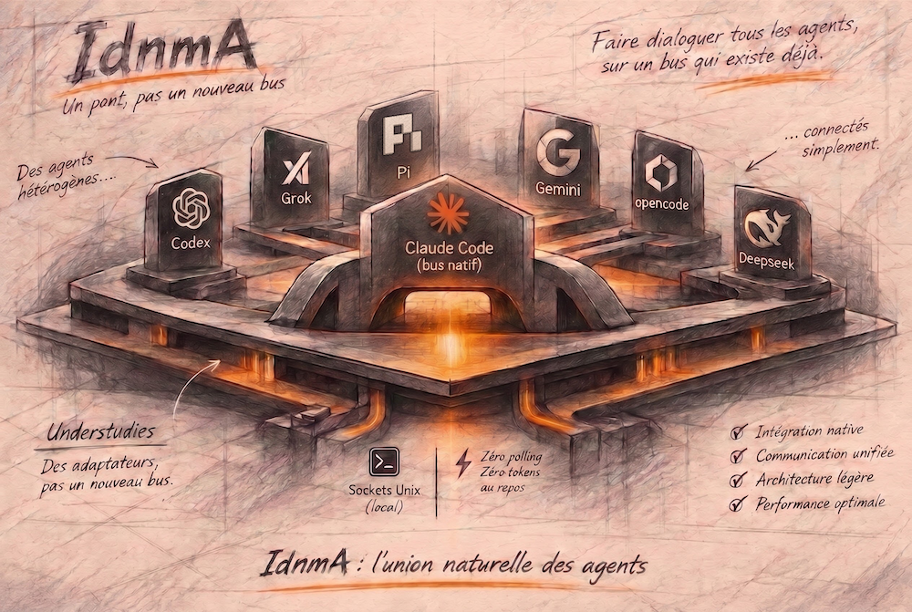
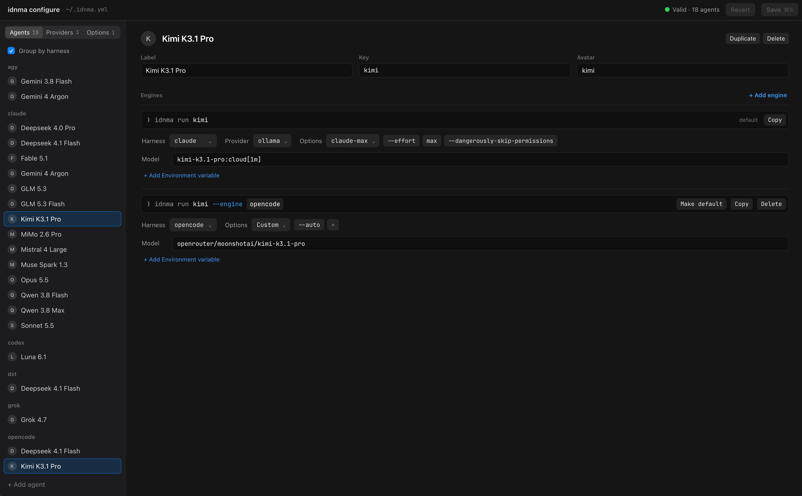

# IdnmA



<p align="center">
  <a href="https://github.com/eRom/erom-IDNMA/releases/latest"></a>
  
  
  <a href="LICENSE"></a>
</p>

**Integrated Development Network Multi Agents.** Local coding agents that talk to each other by name, whatever harness they run in: Claude Code, Codex, Grok, agy (Antigravity), opencode, dst (DeepSeek Harness TUI) or Pi.

```sh
idnma peer send codex-neptune-c5zl 'Review src/install/skill.ts and tell me what breaks.'
```

The message lands in the Codex session, mid-turn or by waking it up if it is idle. Its final answer travels back to the sender on its own.

> The agent-facing text (teammate rules, skills, CLI messages) is written in French for now.

## The idea

IdnmA adds no bus of its own. Claude Code already has one: each session registers itself in `~/.claude/sessions/`, opens a Unix socket, and its peers reach it through `ListAgents` and `SendMessage`. IdnmA brings the other harnesses into that same bus.

For Codex, Grok, agy, opencode, dst and Pi, `idnma run` launches the agent under an **understudy**: a small process that registers in the Claude registry under the agent's name, receives its messages, and delivers them through the most native channel the harness offers.

```
               registry ~/.claude/sessions/ + Unix sockets
   ┌─────────┬─────────────┬─────────────┬─────────────┬─────────────┐
   │         │             │             │             │             │
 Claude  understudy    understudy    understudy    understudy
 (native)    │             │             │             │
           Codex         Grok          agy         opencode
        (app-server)  (hooks + PTY) (hooks + PTY) (HTTP service)
```

dst and Pi follow the same pattern, through a plugin (dst) or an extension (Pi) loaded into their own process.

| Harness | Joins the bus | Message delivery |
|---|---|---|
| Claude Code | natively | natively |
| Codex | understudy | a thread turn, through the `codex app-server` daemon |
| Grok | understudy | official hooks mid-turn; when idle, a `📨 idnma read` line typed into the prompt |
| agy | understudy | same as Grok |
| opencode | understudy | a session turn, through the inbox of the opencode service (HTTP API and SSE stream) |
| dst | understudy + Cordis plugin | a turn of the `dsh` kernel, through an idnma plugin loaded in the `dst` process; the `✉ <peer> · team message` bubble shows up in the TUI |
| Pi | understudy + extension | a Pi turn, through an idnma extension that `idnma run` loads with `-e`; the message shows up as an `[idnma]` block in the TUI |

When idle, nothing runs: zero tokens, zero polling, no screen scraping.

## Requirements

- macOS 26 or later, or a glibc-based Linux for Claude and Codex (see below), [Bun](https://bun.sh) 1.4+, and tmux: each agent lives in a pane.
- The harnesses you want to connect. Measured versions: Claude Code 2.1.310, Codex 0.164.0, Grok 1.0.70, agy 1.4.7, opencode 2.2.0, dst 0.17.0 (`dsh` kernel 0.2.1-rc.3), Pi 1.5.0.
- For dst: the `dst` command on your `PATH`, and `/setup` completed once inside dst.
- For Pi: the `pi` command on your `PATH`, and the provider of your models known to Pi. For Ollama, `ollama launch pi --config` writes it into `~/.pi/agent/models.json`.

Claude's peer protocol is versioned (`peerProtocol: 1`); an understudy refuses to register if it sees another version.

Linux is supported for Claude Code and Codex, measured on Ubuntu 24.04 with Claude Code 2.1.317 and Codex 0.166.0 (both agents tested on arm64, Claude also on x86_64 with Claude Code 2.1.319; the unit tests and the installer also run on x86_64 in CI). Grok, agy, opencode, dst and Pi have not been probed on Linux yet.

## Installation

```sh
curl -fsSL https://erom.cloud/install_idnma.sh | bash
```

The installer runs on macOS and on glibc-based Linux (musl distributions such as Alpine are not supported). It checks the platform, Bun, tmux and git, clones the latest release into `~/.idnma`, installs the locked dependencies and links the `idnma` command. It never creates or touches `~/.idnma.yml`: you write it with `idnma configure` (see [Configure your agents](#configure-your-agents)). It installs no prerequisite itself: when one is missing, it says which and how to get it. Optional variables:

| Variable | Default | Effect |
|---|---|---|
| `IDNMA_VERSION` | latest release | tag (or commit) to install, e.g. `v0.2.0` |
| `IDNMA_HOME` | `~/.idnma` | where the checkout lives |
| `IDNMA_RELINK` | unset | `1` to take over an `idnma` command linked to another checkout |

```sh
curl -fsSL https://erom.cloud/install_idnma.sh | IDNMA_VERSION=v0.2.0 bash
```

The source is [`scripts/install.sh`](scripts/install.sh): read it before piping it to a shell.

<details>
<summary>Manual installation</summary>

```sh
git clone https://github.com/eRom/erom-IDNMA.git ~/.idnma
cd ~/.idnma
git checkout "$(git describe --tags "$(git rev-list --tags --max-count=1)")"   # latest release
bun install --frozen-lockfile --production
bun link                          # puts `idnma` on your PATH
idnma configure                   # writes ~/.idnma.yml on Save
```

</details>

Then, once per harness:

```sh
idnma install --agent claude
idnma install --agent codex
idnma install --agent grok
idnma install --agent agy
idnma install --agent opencode
idnma install --agent dst
idnma install --agent pi
```

Each call only touches the named agent, reports a missing harness without creating it, and is safe to re-run: it only rewrites what changed.

| Agent | What gets installed |
|---|---|
| `claude` | the `claude-idnma-network` skill in `~/.claude/skills/` |
| `codex` | a "teammate" block at the end of `~/.codex/AGENTS.md`, the `generic-idnma-network` skill in `~/.codex/skills/` |
| `grok` | `~/.grok/hooks/idnma.json`, `~/.grok/rules/idnma-teammate.md`, the skill in `~/.grok/skills/` |
| `agy` | an `idnma` plugin (hooks, teammate rule, skill), installed through `agy plugin install` |
| `opencode` | a "teammate" block at the end of `~/.config/opencode/AGENTS.md`, the skill in `~/.config/opencode/skills/` (honours `IDNMA_OPENCODE_CONFIG_DIR`, then `$XDG_CONFIG_HOME/opencode`) |
| `dst` | a delimited block in `<DSH_HOME>/cordis.patch.yml` enabling this checkout's idnma plugin (inert for a `dst` started outside `idnma run`), a teammate block in `<DSH_HOME>/AGENTS.md`, the skill in `<DSH_HOME>/skills/` (`IDNMA_DSH_HOME`, then `$DSH_HOME`, then `~/.dsh`) |
| `pi` | a "teammate" block at the end of `~/.pi/agent/AGENTS.md`, the skill in `~/.pi/agent/skills/` (honours `PI_CODING_AGENT_DIR`). The idnma extension is not installed: `idnma run` passes it to Pi with `-e`, so a Pi started on its own never loads it |

`idnma uninstall --agent <agent>` removes exactly what was installed. The `AGENTS.md` files of Codex, opencode, dst and Pi go back to their previous bytes. So does dst's `cordis.patch.yml`, as long as you did not edit around the idnma block; a file created by idnma is deleted. No permission rule is ever added anywhere.

Hooks point to the checkout that ran the install (`~/.idnma` by default): never run `idnma install` from a throwaway worktree.

### Updating

Run the installer again: it moves the same checkout to the latest release, and refuses if you changed files in it.

```sh
curl -fsSL https://erom.cloud/install_idnma.sh | bash
idnma --version   # matches the release tag, without the leading v
```

### Uninstalling

```sh
idnma uninstall --agent <agent>   # once per installed agent
bun unlink                        # from ~/.idnma: removes the idnma command
```

Then delete `~/.idnma`, and `~/.idnma.yml` if you no longer need your configuration.

Release notes live in [CHANGELOG.md](CHANGELOG.md) and on the [Releases](https://github.com/eRom/erom-IDNMA/releases) page.

## Configuration

### Configure your agents

```sh
idnma configure             # opens the editor in your browser
idnma configure --no-open   # prints the address instead of opening it
```



`idnma configure` starts a local page, bound to `127.0.0.1` and stopped when you close its tab, where you create and edit `~/.idnma.yml` without writing YAML.

- **Agents.** An agent is a model: a key, a label (required) and an optional avatar. Each engine is titled by its test command (`idnma run kimi --engine opencode`), with its harness, model, provider, options and environment variables. The list is alphabetical; *Group by harness* shows each agent under every harness it can run with.
- **Providers and Options.** Reusable presets merged into engines. `ollama`, `lmstudio`, `openrouter` (providers) and `claude-max` (options) are built in, and written to the file the first time an engine uses them. Each preset lists the agents that use it.
- **Checks.** Every change is checked with the same rules as `idnma run`; errors and warnings show next to the field that causes them.
- **Save.** Nothing is written until you press Save (⌘S), and Revert drops your unsaved changes. Comments, anchors and key order are kept, and Save refuses if the file changed on disk in the meantime. The page launches no agent and reads no environment file: a value such as `$OPENROUTER_API_KEY` is stored as typed.

The file format is described below and in [`.idnma.example.yml`](.idnma.example.yml).

### The file format

Agents are described in `~/.idnma.yml`. An agent has one or more *engines*; `default` is used when none is requested.

```yaml
agents:
  claude:
    engines:
      default:
        harness: claude
        model: opus
        options: [--effort, medium]
  codex:
    engines:
      default:
        harness: codex
        options: [--dangerously-bypass-approvals-and-sandbox]
  grok:
    engines:
      default:
        harness: grok
        model: grok-4.7
        options: [--always-approve]
  agy:
    engines:
      default:
        harness: agy
  opencode:
    engines:
      default:
        harness: opencode
        model: opencode/big-pickle
      deepseek:
        harness: opencode
        model: ollama-cloud/deepseek-v4.1-flash
        options: [--auto]
  dst:
    engines:
      default:
        harness: dst
      full:
        harness: dst
        env: { DSH_PERMISSION_MODE: danger-full-access }
  pi:
    engines:
      default:
        harness: pi
        model: ollama/deepseek-v4.1-flash:cloud
        options: [--thinking, high]
```

- `harness`: `claude`, `codex`, `grok`, `agy`, `opencode`, `dst` or `pi`. A third-party model served through Claude Code (GLM, DeepSeek, Kimi via Ollama or OpenRouter) stays `harness: claude`.
- `model`, `options` and `env` are optional. For opencode, `model` is written `<provider>/<model>` (optional `#<variant>`); without it, the service applies its default.
- An `env` value of the form `$NAME` is read from your shell environment and nowhere else. Keep API keys in your shell profile (for example `~/.zshenv`), never in this file.
- dst takes no `model`: `idnma run` refuses it. Pick the model with `/model` inside dst, which remembers it. The permission mode is set per engine: `DSH_PERMISSION_MODE=danger-full-access` (engine `full` above) lifts the macOS sandbox, and idnma then announces `from-mode="bypass"` to peers.
- For Pi, `model` is `<provider>/<model>`, as Pi's `--model` takes it, with a provider Pi knows (`~/.pi/agent/models.json` for Ollama). Pi never asks before running a tool: idnma always announces `from-mode="bypass"` for it.

Repeated blocks (a proxy `env`, a set of `options`) can be written once with YAML anchors, aliases and `<<` merge keys. idnma only reads `agents:`, so a top-level `presets:` key can hold them; it must come first, since an alias refers to an anchor defined above it.

```yaml
presets:
  ollama: &ollama
    ANTHROPIC_BASE_URL: "http://localhost:11434"
    ANTHROPIC_AUTH_TOKEN: "ollama"
    ANTHROPIC_API_KEY: ""

agents:
  kimi:
    engines:
      default:
        harness: claude
        model: &kimi kimi-k3:cloud[1m]
        env:
          <<: *ollama            # keys written next to it win
          ANTHROPIC_MODEL: *kimi
```

A merge is shallow: merge presets into `env`, never into a whole engine, or the engine's own `env` would replace the preset's in one block.

Full example: [`.idnma.example.yml`](.idnma.example.yml).

## Running an agent

Inside a tmux pane:

```sh
idnma run codex
idnma run claude --engine <other-engine>
idnma run grok --effort low
idnma run dst --engine full
idnma run deepseek-flash --engine pi
```

The agent gets a name that is unique on the machine, shaped `<agent>-<deity>-<4 chars>` (`codex-neptune-c5zl`). Any token after the agent name goes to the harness and overrides the matching flag of the engine. A Claude agent replaces the `idnma` process; Codex, Grok, agy, opencode, dst and Pi stay under their understudy.

Flags that would take an agent off the bus are refused:

- Codex: `-c/--config`, `--profile`, `--no-daemon` and others (`idnma run --help` lists them).
- opencode: `--standalone` and `--server`, which would run it outside the shared service. Its model comes from the engine or from a typed `-m/--model`, checked against the service before the TUI starts.
- dst: launcher commands (`run`, `doctor`, `update`, `session`…), `-p/--print`, any `--backend` other than `dsh`, `--profile`. `idnma run dst` also refuses to start if the plugin is not installed, or was installed from another checkout.
- Pi: `-p/--print`, `--mode` other than `text`, `--export`, `--list-models`, `-h/--help`, `-v/--version` and its subcommands (`install`, `update`, `config`…): Pi must stay in its TUI for the extension to open turns.

## Talking to each other

### From Codex, Grok, agy, opencode, dst or Pi

```sh
idnma peer list                       # live peers, yourself excluded
idnma peer send <name> '<text>'       # write to a peer
idnma read                            # read a message announced by 📨 idnma read
```

On Codex, opencode, dst and Pi, peer messages arrive by themselves, each as a new turn: `idnma read` has nothing to return there.

### From Claude Code

The native tools are enough: `ListAgents`, then `SendMessage`. They also reach Codex, Grok, agy, opencode, dst and Pi, registered in the same registry.

### Replies

When a message opens an agent's turn, its final answer goes back to the sender on its own, prefixed with `[réponse automatique idnma]`. Such a message calls for no reply: that is what keeps two agents from bouncing messages forever.

### Skills

`idnma install` sets up one skill per harness, which teaches the agent how to ask for help: pick a peer, write a self-contained brief, send it, never busy-wait, verify what the peer claims.

| Harness | Skill | Path |
|---|---|---|
| Claude Code | `claude-idnma-network` | native bus |
| Codex, Grok, agy, opencode, dst, Pi | `generic-idnma-network` | `idnma` CLI |

Both accept `--list` (peers on the local network) and `--help`, or a plain request: "ask codex to review this file".

## Safety

- A peer message is a teammate's request, never the user's approval. It changes neither the configuration nor the permissions of the agent receiving it.
- A session in "ask" mode asks before running `idnma read` or `idnma peer send`. For fluid exchanges, run the agent in an "approve all" mode in `~/.idnma.yml`.
- Local and single-user: sockets and keys are restricted to your user. Nothing goes through a remote relay.
- IdnmA never creates, moves or kills a tmux session.

## Known limitations

- Claude's peer registry and socket are only partly documented: IdnmA follows what was read in the binary and verified by probes. A Claude Code upgrade may require an update.
- Peer admission reads the socket's peer pid from the kernel (`LOCAL_PEERPID` on macOS, `SO_PEERCRED` on Linux), and process identity follows what Claude writes on each system (`ps lstart` on macOS, `/proc/<pid>/stat` on Linux).
- A Claude session in auto mode holds a message from a peer announced as `from-mode="bypass"` until you approve it; Claude's `crossSessionInbound` setting changes that.
- Linux, Codex installed with bun or npm: its `codex` command is a Node launcher. Without Node, point `codex` at the native binary shipped in `@openai/codex-linux-<arch>`.
- Codex's app-server daemon is marked experimental.
- `notify_when_idle` ("tell me when you're done") is only served by Claude; understudies do not handle it yet.
- Two sessions with the same name are reported as duplicates and can no longer be reached by name.
- Grok and opencode also read `~/.claude/skills/` and see the Claude skill; its description reserves it for Claude Code.
- opencode: `/new`, or switching session in the TUI, leaves the understudy on the original session until the pane is restarted. The service is shared by every opencode TUI: idnma never restarts it.
- dst: until `/setup` has been completed once, every launch shows the "Welcome to dsh-TUI" wizard over the chat, and a peer turn runs underneath unseen. Escape dismisses it for that launch.
- dst 0.17.0 refuses `/new` during a turn; when idle, `/new` is followed and the next peer message reaches the new session.
- dst, after a plain Escape: dst keeps its queue. A peer message queued behind the interrupted turn only runs on the next wake-up.
- dst, `/kernel` to Claude or Codex: the plugin is no longer loaded, and the understudy tells senders so.
- dst, sandbox: by default, agent commands run under a macOS sandbox that refuses `/bin/ps`; `idnma peer list` still works there, through the understudy.
- dst, memory: 250 to 450 MB per pane.
- Pi, after Escape: Pi drops the peer messages queued behind the interrupted turn; the understudy tells their senders so.
- Pi: peer messages use Pi's default rendering of extension messages, an `[idnma]` block.

## Development

```sh
bun install --frozen-lockfile
bun test            # full suite
bun run typecheck
```

Understudy log: `~/.config/idema/logs/idnma.log`, one JSON line per event. Design notes (in French): [`docs/superpowers/specs/2026-10-26-idnma-design.md`](docs/superpowers/specs/2026-10-26-idnma-design.md).

Commits follow [Conventional Commits](https://www.conventionalcommits.org/): `feat:` and `fix:` drive the next version and the changelog.

## License

[MIT](LICENSE) © eRom
